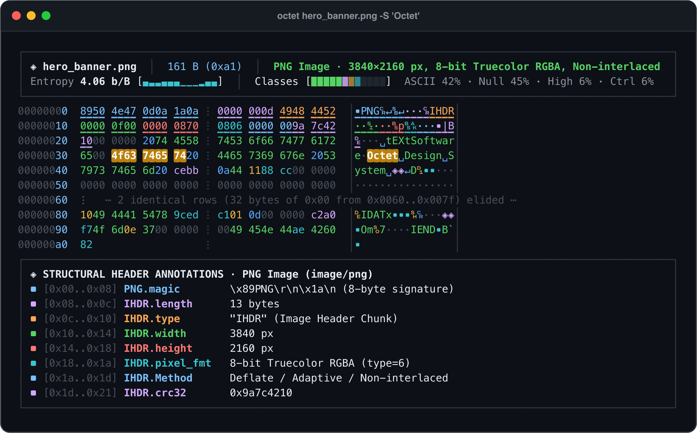

# `octet`

[](https://github.com/oddurs/octet/actions/workflows/ci.yml)
[](LICENSE)

**Information-design-first hex viewer, binary inspector, and modern `xxd` / `hexdump` alternative.**

`octet` is a single-crate, zero-dependency Rust library and CLI engineered around visual hierarchy, semantic byte typography, and automatic structural header annotations.



---

## Visual Tour

### Mach-O 64-bit ARM64 Header Decoding & Multi-Type Data Inspector (`--inspect`)


### Side-by-Side Binary Diff (`--diff`)


### Daylight Paper Theme (`--theme light`) & Binary Bit View (`-b -q`)


---

## Information Design System

Classic `xxd` assigns identical visual weight to every byte. `octet` separates figure from ground using 7 semantic byte classes and calibrated dark/light palettes:

| Byte Class | Range / Condition | Glyph | Visual Role |
| :--- | :--- | :--- | :--- |
| **`Null`** | `0x00` | `·` | Recedes into negative space so structural non-zero fields stand out immediately. |
| **`AsciiGraphic`** | `0x21..=0x7E` | Exact ASCII | High-contrast emerald for immediate string and identifier legibility. |
| **`AsciiWhitespace`** | `0x20`, `\t`, `\n`, `\r` | `␣`, `⇥`, `↵`, `␍` | Sky-blue typographic symbols that distinguish spaces from newlines and null bytes. |
| **`AsciiControl`** | `0x01..=0x1F`, `0x7F` | `␁`..`␟`, `␡` | Warm amber Unicode Control Pictures for control characters and small integer fields. |
| **`Utf8MultiByte`** | Valid multi-byte UTF-8 | `◈` | Soft lavender binding lead and continuation bytes in international text. |
| **`HighByte`** | `0x80..=0xFE` | `▪` | Electric teal signaling compressed streams, encrypted payloads, or machine code. |
| **`Sentinel`** | `0xFF` | `×` | Coral highlight making `-1` integers, bitmasks, and flash-erased blocks unmistakable. |

---

## Known File Header Structural Annotations

When inspecting a binary from offset `0x00`, `octet` automatically recognizes and annotates byte-range fields for:

- **Executables & Modules**: **ELF** (32/64-bit, LE/BE, `e_type`, `e_machine`, `e_entry`, `e_phoff`, `e_shoff`), **Mach-O** (32/64-bit & Universal Fat binaries, `cputype`, `filetype`, `ncmds`, `flags`, `LC_SEGMENT_64`), **PE / MZ** (`DOS.e_magic`, `e_lfanew`, `PE\0\0`, `COFF.Machine`), **WebAssembly** (`\0asm`, version, section headers).
- **Images, Archives & Databases**: **PNG** (signature + full `IHDR` dimensions, bit depth, color type, CRC-32), **ZIP / JAR / Wheel** (`PK\x03\x04` local header, compression method, CRC-32, sizes, filename), **SQLite 3** (header magic, page size, page count), **GZIP**, **Zstandard**, **PDF**, **JPEG**, **GIF**, **UTF-8 BOM**, and **Shebang (`#!`)**.

---

## Installation & Usage

```bash
cargo install --path .
```

### Common Commands

```bash
# Smart annotated view (default)
octet firmware.bin

# Highlight ASCII or hex patterns and inspect multi-type values at offset 0x98
octet arm64_bin.macho -S "TEXT" --inspect 0x98

# Side-by-side binary diff
octet firmware_v1.bin --diff firmware_v2.bin

# Seek to last 64 bytes from EOF, or slice 256 bytes starting at 4KiB
octet image.bin -s -64
octet image.bin -s 4KiB -l 256

# Generate source code arrays in Rust, C, Go, Python, or TypeScript
octet payload.bin -i --lang rust

# Round-trip reverse (works on smart octet dumps, classic xxd dumps, or -r -p plain hex)
octet payload.bin | octet -r > restored.bin

# Export a grid-locked vector SVG terminal window diagram
octet hero_banner.png -S "Octet" --svg preview.svg
```

---

## Development & Git Workflow

```bash
# Enable local pre-commit, commit-msg, and pre-push git hooks
git config core.hooksPath .githooks

# Run all checks
cargo fmt --all -- --check
cargo clippy --all-targets -- -D warnings
cargo test --all-targets
```

## License

MIT License — see [LICENSE](LICENSE).
