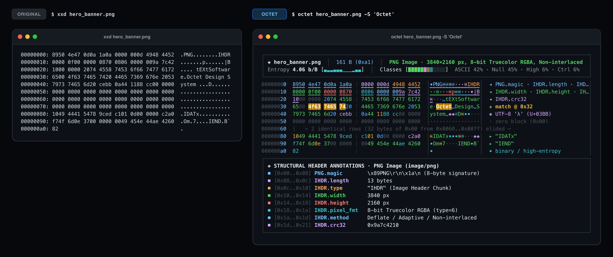
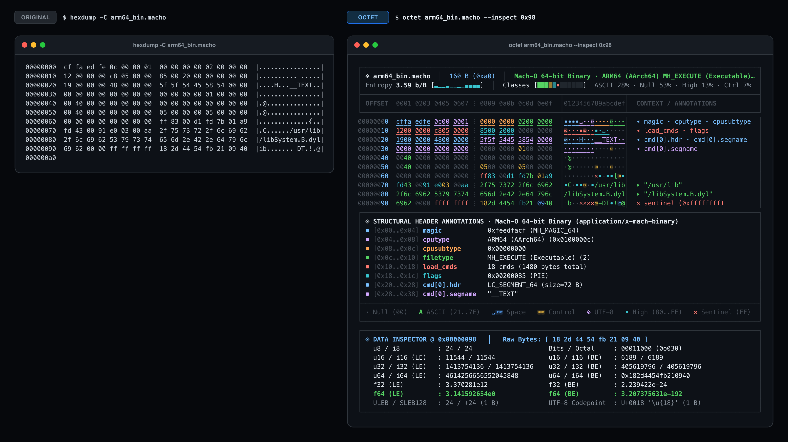
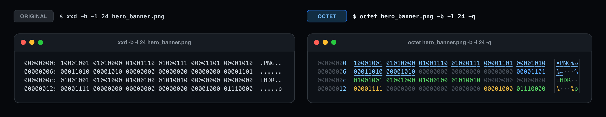
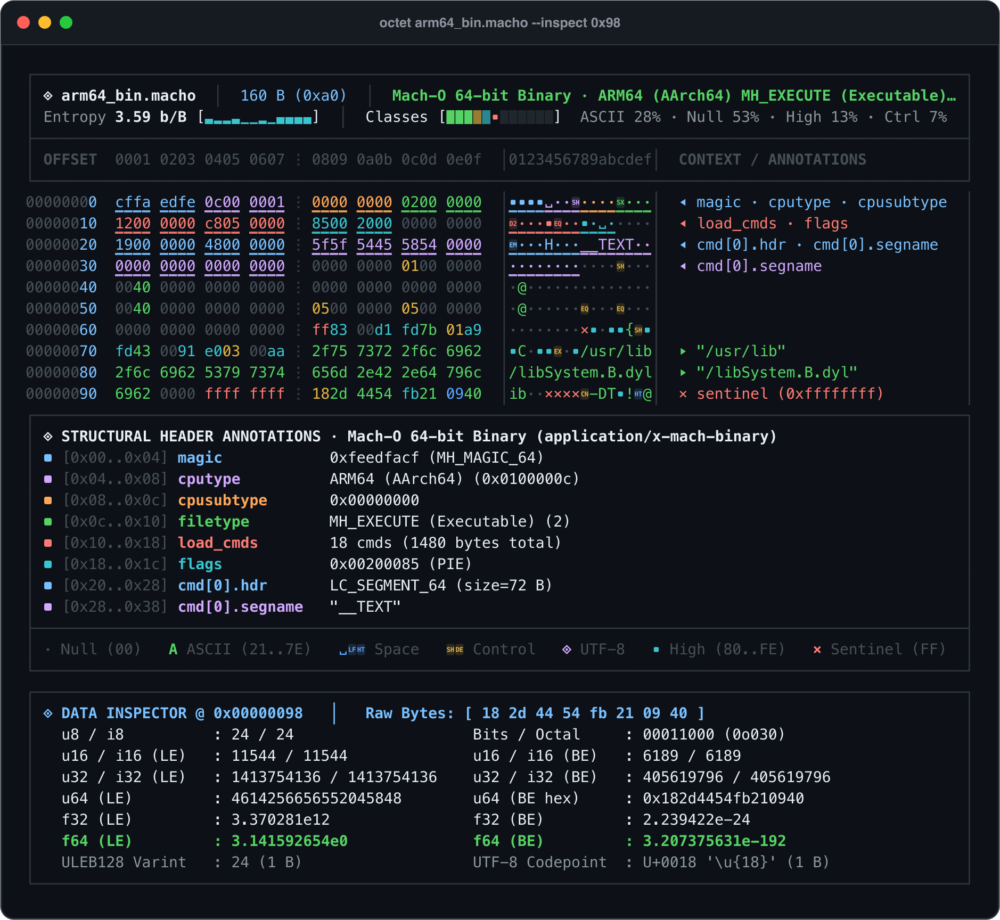
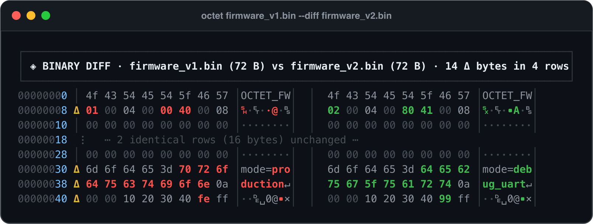
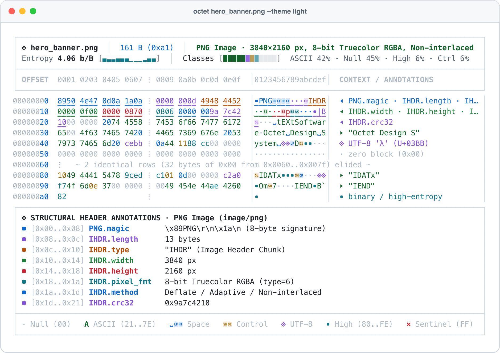
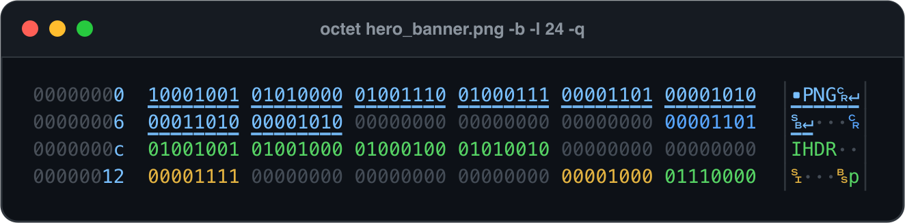

# `octet`

[](https://github.com/oddurs/octet/actions/workflows/ci.yml)
[](LICENSE)

**Information-design-first hex viewer, binary inspector, and modern `xxd` / `hexdump` alternative.**

`octet` is a single-crate, zero-dependency Rust library and CLI engineered around visual hierarchy, semantic byte typography, and automatic structural header annotations.

## `octet` vs Originals (`xxd` & `hexdump -C`)

### `xxd` vs `octet` (PNG Header, UTF-8, Search & Zero-Run Elision)


### `hexdump -C` vs `octet` (Mach-O 64-bit ARM64 Header & Data Inspector)


### `xxd -b` vs `octet -b -q` (Binary Bit Dump)


---

## Visual Tour

### Mach-O 64-bit ARM64 Header Decoding & Multi-Type Data Inspector (`--inspect`)


### Side-by-Side Binary Diff (`--diff`)


### Daylight Paper Theme (`--theme light`) & Binary Bit View (`-b -q`)



---

## Information Design System

Classic `xxd` assigns identical visual weight to every byte. `octet` separates figure from ground using 7 semantic byte classes and calibrated dark/light palettes:

| Byte Class | Range / Condition | Glyph | Visual Role |
| :--- | :--- | :--- | :--- |
| **`Null`** | `0x00` | `·` | Recedes into negative space so structural non-zero fields stand out immediately. |
| **`AsciiGraphic`** | `0x21..=0x7E` | Exact ASCII | High-contrast emerald for immediate string and identifier legibility. |
| **`AsciiWhitespace`** | `0x20`, `\t`, `\n`, `\r` | `␣`, `⇥`, `↵`, `␍` | Sky-blue typographic symbols that distinguish spaces from newlines and null bytes. |
| **`AsciiControl`** | `0x01..=0x1F`, `0x7F` | `␁`..`␟`, `␡` | Warm amber Unicode Control Pictures for control characters and small integer fields. |
| **`Utf8MultiByte`** | Valid multi-byte UTF-8 | `◈` | Soft lavender binding lead and continuation bytes in international text. |
| **`HighByte`** | `0x80..=0xFE` | `▪` | Electric teal signaling compressed streams, encrypted payloads, or machine code. |
| **`Sentinel`** | `0xFF` | `×` | Coral highlight making `-1` integers, bitmasks, and flash-erased blocks unmistakable. |

---

## Known File Header Structural Annotations (31+ Formats)

When inspecting a binary from offset `0x00`, `octet` automatically recognizes and annotates byte-range fields for:

- **Executables & Bytecode**: **ELF** (32/64-bit, LE/BE, `e_type`, `e_machine`, `e_entry`, `e_phoff`, `e_shoff`), **Mach-O** (32/64-bit & Universal Fat binaries, `cputype`, `filetype`, `ncmds`, `flags`, `LC_SEGMENT_64`), **Java `.class`** (`0xCAFEBABE` disambiguated from Universal Mach-O), **PE / MZ** (`DOS.e_magic`, `e_lfanew`, `PE\0\0`, `COFF.Machine`), **WebAssembly** (`\0asm`, version, section headers), **Android DEX**, **LLVM IR Bitcode**, and **Shebang (`#!`)**.
- **Archives & Compression**: **ZIP / JAR / Wheel** (`PK\x03\x04` local header, compression method, CRC-32, sizes, filename), **POSIX `ustar` TAR**, **7-Zip**, **GZIP**, **Zstandard**, **XZ**, **bzip2**, and **LZ4**.
- **Media, Captures, Databases & Fonts**: **PNG** (signature + full `IHDR` dimensions, bit depth, color type, CRC-32), **JPEG**, **GIF**, **WebP**, **MP4 / MOV / HEIC / AVIF** (`ftyp`), **RIFF WAVE / AVI**, **FLAC**, **Ogg**, **PCAP** & **PCAPNG** packet captures, **SQLite 3** (header magic, page size, page count), **PDF**, **WOFF / WOFF2 / OpenType**, and **UTF-8 BOM**.

---

## Installation & Usage

```bash
cargo install --path .
```

### Common Commands

```bash
# Smart annotated view (default)
octet firmware.bin

# Canonical BSD/GNU 'hexdump -C' or strict 'xxd' compatibility modes
octet -C firmware.bin
octet --classic firmware.bin

# Highlight ASCII or hex patterns and inspect multi-type values at offset 0x98
octet arm64_bin.macho -S "TEXT" --inspect 0x98

# Side-by-side binary diff
octet firmware_v1.bin --diff firmware_v2.bin

# Structured RFC 8259 JSON report (telemetry, header fields, search hits, inspection, or diff)
octet -j --inspect 0x98 arm64_bin.macho

# Seek to last 64 bytes from EOF, or slice 256 bytes starting at 4KiB
octet image.bin -s -64
octet image.bin -s 4KiB -l 256

# Generate source code arrays in Rust, C, Go, Python, or TypeScript
octet payload.bin -i --lang rust

# Round-trip reverse (works on smart octet dumps, classic xxd, hexdump -C, or -r -p plain hex)
octet payload.bin | octet -r > restored.bin

# Export a grid-locked vector SVG terminal window diagram
octet hero_banner.png -S "Octet" --svg preview.svg

# Generate shell completions (bash, zsh, fish) and troff manual page
octet --completions zsh > _octet
octet --man > octet.1
```

### Library Usage

```rust
use octet::{FormatOptions, ViewStyle, inspect_header, render_dump, reverse_dump};

let payload = b"\x89PNG\r\n\x1a\n\x00\x00\x00\x0dIHDR";
let header = inspect_header(payload).expect("recognizes PNG header");
assert_eq!(header.format_name, "PNG Image");

let opts = FormatOptions {
    style: ViewStyle::Smart,
    color: false,
    ..FormatOptions::default()
};
let dump = render_dump(payload, &opts);
let restored = reverse_dump(&dump, false).unwrap();
assert_eq!(restored, payload);
```

---

## Development & Git Workflow

```bash
# Enable local pre-commit, commit-msg, and pre-push git hooks
git config core.hooksPath .githooks

# Run all checks
cargo fmt --all -- --check
cargo clippy --all-targets -- -D warnings
cargo test --all-targets
```

## License

MIT License — see [LICENSE](LICENSE).
